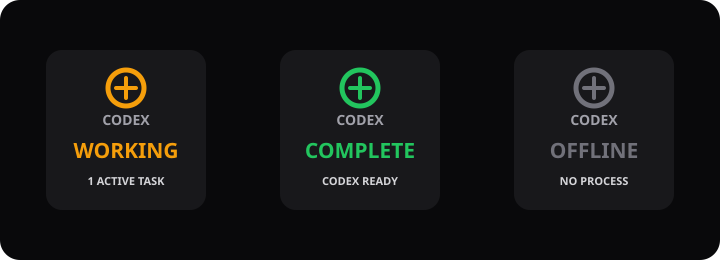

# Codex Status for OpenDeck

[](https://github.com/ChrisTitusTech/streamdeck-dashboard/actions/workflows/ci.yml)
[](https://github.com/ChrisTitusTech/streamdeck-dashboard/releases/latest)
[](LICENSE)

An [OpenDeck](https://github.com/nekename/OpenDeck) plugin for Linux that turns a Stream Deck key into a live Codex and T3 Code task indicator, including work on linked machines.



| State | Meaning |
| --- | --- |
| Amber **WORKING** | At least one local Codex session or monitored T3 thread is active. |
| Green **COMPLETE** | All observed work is idle and every configured T3 source was reached. |
| Red **UNKNOWN** | A configured T3 source could not be checked and no known work is active. |
| Gray **OFFLINE** | No local `codex` process is running. |

The key polls once per second after the previous poll finishes. Press it to force an immediate refresh. With T3 connected, it shows separate T3/local counts and rotates through busy machine names and counts every three seconds. Connection failures remain visible, including while other machines are working.

## Install

Requirements:

- Linux
- [OpenDeck](https://github.com/nekename/OpenDeck) 2.13 or newer
- Node.js 18 or newer installed on the host
- A local Codex client that writes session rollouts under `CODEX_HOME` (normally `~/.codex`)

1. Download the latest `codex-status-v*.streamDeckPlugin` file from [GitHub Releases](https://github.com/ChrisTitusTech/streamdeck-dashboard/releases/latest).
2. Open **OpenDeck > Settings > Plugins**.
3. Choose **Install plugin from file** and select the downloaded file.
4. Find the **Codex** category and drag **Codex Status** onto a key.

OpenDeck's Flatpak build still requires Node.js to be installed natively on the host. See the [complete installation guide](docs/INSTALL.md) for updates, source installs, and troubleshooting.

## Connect T3 Code

Run `npm run connect:t3` from a source checkout on the OpenDeck host while T3 Code is running. Open the printed URL on that host and select **read-only** access. The setup discovers the local server automatically; pass a T3 server URL with `npm run connect:t3 -- https://your-t3-server` to connect another server. See [T3 setup](docs/INSTALL.md#connect-t3-code) for configuration and troubleshooting.

## How it works

The plugin identifies same-user `codex` processes through Linux `/proc`, follows the exact rollout file each process already has open, and tracks only these lifecycle events:

- `task_started`
- `task_complete`
- `turn_aborted`

Local Codex detection only consumes lifecycle events. Optional T3 monitoring uses authenticated MCP requests to the configured server and its linked environments. It requests thread summaries (including titles and provider metadata), retains only activity counts and machine labels, and never requests thread messages or source files. Its access token is stored in a separate local file and sent only to its configured endpoint.

Multiple Codex sessions are supported. If any live session is working, the key remains amber and shows the number of active tasks. The key changes to green only when every running session is idle.

## Scope

Local Codex detection covers same-user Linux processes. Optional T3 monitoring covers all providers, projects, and subagent threads returned by each configured server and its directly linked environments. Preparing, queued, starting, running, and waiting threads count as active; waiting includes work that needs user input. Counts represent threads, not individual shell commands or tool calls.

T3 and local Codex counts can overlap, so they are displayed separately. Remote work requires a T3 connection or linked environment; standalone remote Codex and cloud-only tasks remain outside scope. Machines only saved as desktop connections must be connected separately if they are not linked on the monitored server. Linked-environment discovery requires the T3 Labs feature; set `includeLinked` to `false` for a standalone server.

## Development

```bash
npm install
npm run check
npm test
npm run package
```

The release command creates:

```text
release/codex-status-vX.Y.Z.streamDeckPlugin
```

For local development installation:

```bash
npm run build
node scripts/install.mjs --slot 0
```

The development installer backs up the selected OpenDeck profile before changing it. Standard users should install the release file through OpenDeck instead.

See [Development](docs/DEVELOPMENT.md) for architecture, validation, packaging, and release details.

## Contributing

Bug reports and pull requests are welcome. Read [CONTRIBUTING.md](CONTRIBUTING.md) and [SECURITY.md](SECURITY.md) before opening an issue involving security-sensitive behavior.

## License

[MIT](LICENSE) - Copyright (c) 2026 Chris Titus Tech.
